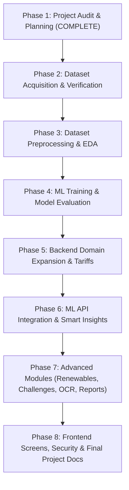

# AquaWatt — Water & Electricity Tracking App
## Master Implementation Plan (Phases 1 through 8)

**Date:** November 15, 2026  
**Project:** Final-Year Major Project — AquaWatt  
**Status:** Phase 1 Complete — Moving to Phase 2 Approval  
**Architecture:** FastAPI + PostgreSQL + SQLAlchemy + Kivy/KivyMD + Scikit-Learn

---

## Roadmap Overview

---

## Phase 1: Project Audit, Architecture Review & Test Baseline
*Status: COMPLETED (November 15, 2026)*

### Objectives
- Inspect existing codebase, backend routes, database models, schemas, and mobile screens.
- Check Git working tree and safeguard all uncommitted changes.
- Execute existing pytest test suite and record baseline results.
- Review technical debt, bugs, and architectural limitations.
- Produce project audit report and comprehensive implementation plan.

### Deliverables
- [x] `AQUAWATT_PROJECT_AUDIT.md`: In-depth analysis of existing system, test results, and limitations.
- [x] `machine_learning/DATASET_RESEARCH.md`: Exhaustive evaluation of real-world electricity and water datasets.
- [x] `AQUAWATT_IMPLEMENTATION_PLAN.md`: Phase-by-phase implementation roadmap.

---

## Phase 2: Dataset Selection, Source Verification & Acquisition
*Target: Immediate Next Step*

### Objectives
- Confirm user approval for recommended primary datasets:
  - **Electricity:** UCI Individual Household Electric Power Consumption (CC BY 4.0, DOI: 10.24432/C58K54).
  - **Water:** HSB Living Lab Fixture-Level Dataset (Zenodo CC BY 4.0, DOI: 10.5281/zenodo.10897107) and SmartH2O Anonymized Dataset (Zenodo CC BY 4.0, DOI: 10.5281/zenodo.556152).
- Establish raw and processed directory structure:
  - `data/raw/electricity/`
  - `data/raw/water/`
  - `data/processed/`
- Download or ingest raw dataset files and verify checksums/hashes.
- Guarantee that raw files remain immutable and never modified in place.

### Deliverables
- `data/raw/electricity/household_power_consumption.zip`
- `data/raw/water/HSB_Living_Lab_Data_Package.zip`
- `machine_learning/requirements.txt` (pandas, numpy, scikit-learn, joblib, matplotlib, seaborn)

### Verification Gate
- Verify raw archive extraction, file sizes, and checksum integrity.
- Ensure no data file is committed directly to Git without `.gitignore` size rules.

---

## Phase 3: Dataset Inspection, Preprocessing, EDA & Documentation
*Target: Week 1*

### Objectives
- Inspect raw data formats, column types, delimiter structures, and missing values.
- Handle missing measurements (e.g. 1.25% missing in UCI dataset) using forward-fill and calendar-aware interpolation.
- Resample continuous time-series into standard hourly, daily, and monthly intervals:
  - Electricity: Minute-level active power (kW) converted to hourly/daily/monthly kWh ($kWh = \frac{\sum kW \times \Delta t}{60}$).
  - Water: 10-minute pulse litres converted to daily and monthly litres per fixture category.
- Feature Engineering:
  - Temporal features: Month, Day of Week, Day of Year, Is Weekend, Season.
  - Lag features: Previous day consumption ($t-1$), previous week consumption ($t-7$), previous month ($t-30$).
  - Rolling window statistics: 7-day rolling mean, 7-day rolling standard deviation, 30-day rolling mean.
  - Context vectors: Appliance inventory counts and household occupancy counts.
- Create reproducible preprocessing pipeline script.
- Generate exploratory data visualizations (seasonal patterns, diurnal load curves, fixture contribution pie charts).

### Deliverables
- `machine_learning/preprocessing.py`: CLI-driven preprocessing and feature engineering script.
- `machine_learning/dataset_report.md`: Complete EDA report with summary statistics, missing value analysis, and visualizations.
- `data/processed/electricity_daily.parquet` and `data/processed/electricity_monthly.parquet`
- `data/processed/water_daily.parquet` and `data/processed/water_monthly.parquet`

### Verification Gate
- Unit tests validating that preprocessing runs deterministically with 0 data leakage.
- Assertion checks on output shape, absence of nulls, and verified metric units (kWh, Litres).

---

## Phase 4: Machine Learning Model Development & Benchmarking
*Target: Week 2*

### Objectives
- Establish chronological train/validation/test split (e.g. first 80% chronological data for training, final 20% for testing). Strictly prevent future-to-past data leakage.
- Implement and train three model families for both Electricity and Water:
  1. **Baseline:** Ridge / Linear Regression.
  2. **Tree Ensemble:** Random Forest Regressor.
  3. **Gradient Boosting:** Gradient Boosting Regressor (or HistGradientBoostingRegressor).
- Evaluation Metrics:
  - Mean Absolute Error (**MAE**) in native units (kWh, Litres).
  - Root Mean Squared Error (**RMSE**).
  - Coefficient of Determination (**$R^2$ score**).
  - Mean Absolute Percentage Error (**MAPE**).
- Feature Importance Analysis: Quantify the contribution of historical lag vs temperature/season vs appliance counts.
- Implement Anomaly Detection: Isolation Forest algorithm trained on normalized consumption deltas to identify genuine consumption spikes.
- Export trained model artifacts and preprocessing scalers using `joblib` into `machine_learning/models/`.

### Deliverables
- `machine_learning/train_electricity.py`: Electricity training and hyperparameter tuning script.
- `machine_learning/train_water.py`: Water training and hyperparameter tuning script.
- `machine_learning/evaluate.py`: Model comparison and metric logging script.
- `machine_learning/predict.py`: Inference engine loading trained pipelines for single-point and sequence forecasting.
- `machine_learning/models/electricity_model.joblib` and `machine_learning/models/water_model.joblib`
- `machine_learning/README.md`: Detailed documentation of model architectures, benchmark results, and instructions for re-training.

### Verification Gate
- Automated tests verifying `predict.py` loads model artifacts and produces valid positive float predictions with bounded variance given mock inputs.
- Evaluation report proving model superiority over naive baseline ($R^2 > 0.70$, MAE within realistic tolerance).

---

## Phase 5: Backend Domain Model Expansion & Tariffs
*Target: Week 3*

### Objectives
- **Household Management Entity:**
  - Decouple `HouseholdProfile` from single-user constraint; introduce `Household` entity.
  - Support `HouseholdMember` with roles (`Owner`, `Member`).
  - Implement secure invitation tokens with expiration timestamps (`/household/invite`, `/household/join`).
- **Sequential Meter Readings:**
  - Support verified meter reading entries: `previous_reading`, `current_reading`, `reading_date`, `meter_number`, `meter_reset_flag`.
  - Validate non-negative consumption ($Consumption = Current - Previous$).
  - Gracefully handle meter replacement/reset events.
- **Utility Tariffs & Budgets:**
  - Add `HouseholdSettings` model storing electricity tariff (\$ or ₹ per kWh), water tariff (\$ or ₹ per 1000L), monthly electricity budget, monthly water budget, and conservation target.
  - Compute transparent monthly bill estimations based on actual readings and tariffs.
- **Structured Appliance & Activity Tracking:**
  - Replace free-text appliance notes with structured `ApplianceItem` model (`name`, `rated_watts`, `quantity`, `hours_per_day`). Calculate estimated kWh and cost per appliance.
  - Replace free-text water notes with structured `WaterActivityItem` model (`name`, `litres_per_occurrence`, `occurrences_per_day`). Calculate estimated daily/monthly water volume.

### Deliverables
- New SQLAlchemy models in `backend/app/models/` (`household.py`, `meter_reading.py`, `tariff.py`, `appliance.py`).
- Pydantic v2 schemas in `backend/app/schemas/`.
- New API routes in `backend/app/routes/` (`household.py`, `appliances.py`, `settings.py`).
- Comprehensive pytest test cases covering multi-tenant household isolation, invalid meter reading sequences, and tariff calculations.

### Verification Gate
- All new endpoints protected by JWT and strict household membership authorization.
- Zero authorization leaks: User A cannot read or write User B's household data.

---

## Phase 6: ML API Integration, Predictions & Smart Insights
*Target: Week 4*

### Objectives
- Integrate `machine_learning/predict.py` with FastAPI as a dedicated, authenticated router (`/ml`):
  - `GET /ml/electricity/prediction`: Returns forecasted next-month electricity consumption (kWh), 95% confidence interval, and estimated bill based on household tariff.
  - `GET /ml/water/prediction`: Returns forecasted next-month water consumption (Litres), daily LPCD estimate, and estimated water bill.
  - `GET /ml/evaluation`: Returns benchmark metrics (MAE, RMSE, $R^2$) of active production models.
  - `GET /ml/anomalies`: Detects whether recent consumption entries represent statistically significant anomalies.
- **Smart Insights Engine:**
  - Develop transparent recommendation service distinguishing:
    1. *Rule-Based Heuristics:* Appliance efficiency recommendations (e.g. AC contributes >40% of electricity bill).
    2. *Statistical Comparisons:* Month-over-month and per-capita benchmarks vs standard urban water guideline (135 LPCD).
    3. *Machine Learning Projections:* Budget breach warnings ("Predicted bill of ₹3,450 exceeds your ₹3,000 monthly budget").
  - Guarantee that predictions are never conflated with actual verified meter readings.

### Deliverables
- `backend/app/routes/ml.py`: FastAPI ML router.
- `backend/app/services/ml_service.py`: Service managing model lifecycle, input vector assembly from DB, and prediction execution.
- `backend/app/services/insights_service.py`: Rule-based and predictive insights generator.
- Pytest suite testing ML endpoints, including fallback behavior when model files are not yet trained.

### Verification Gate
- Endpoints return structured JSON with explicit `unit` tags (`kWh`, `Litres`, `currency`).
- Graceful degradation: If ML models are missing, endpoint returns HTTP 503 or safe heuristics with informative messaging rather than 500 crashes.

---

## Phase 7: Advanced Modules (Renewables, Challenges, OCR & Reports)
*Target: Week 5*

### Objectives
- **Renewable Resource Tracking:**
  - Track solar generation (kWh), grid import, grid export, rainwater harvested (L), and rainwater reused (L).
  - Validation: $Export \le Generation$ and $Rainwater\ Reused \le Rainwater\ Collected$.
  - Display net grid reliance metrics.
- **Weekly Savings Challenges & Streaks:**
  - Weekly challenge engine tracking complete 7-day comparable periods.
  - Savings streak counter and achievement badges (e.g., "5% Water Saver", "Streak: 3 Weeks").
- **Utility Bill OCR (Optional / Sandboxed):**
  - Implement bill text extraction service using `pytesseract` or `pdfplumber`.
  - Crucial requirement: Extracted values are presented as an editable review draft; never saved automatically without human verification.
- **Peer Comparison (Anonymized):**
  - Aggregate consumption by apartment type and household size.
  - Only show benchmarks if cohort contains $\ge 5$ households to preserve privacy.
- **Reports & Exporting:**
  - Export consumption history as structured CSV.
  - Generate formatted PDF monthly utility statement using ReportLab.
- **Optional AI Utility Assistant:**
  - Configurable LLM utility assistant (activated via `AI_ASSISTANT_ENABLED=true` in `.env`). Answers questions about household trends and conservation strategies using aggregated statistics only.

### Deliverables
- `backend/app/routes/renewable.py`, `challenges.py`, `reports.py`, `assistant.py`.
- Automated tests verifying constraint validation, challenge logic, and export generation.

---

## Phase 8: Mobile UI Integration, Security Review & Project Documentation
*Target: Week 6*

### Objectives
- **Frontend Liquid-Glass Screens:**
  - Build and connect screens for:
    - `PredictionsScreen`: Visual forecast cards with confidence bands and budget progress.
    - `SmartInsightsScreen`: Categorized recommendations (Appliances, Habits, Budget).
    - `ApplianceTrackerScreen`: Interactive sliders for wattage and hours/day.
    - `HouseholdSettingsScreen`: Editable tariffs, budgets, and occupancy settings.
    - `RenewableScreen`: Solar generation vs grid reliance gauges.
    - `ChallengesScreen`: Active weekly challenges, badges, and streaks.
    - `ReportsScreen`: Export CSV and download PDF buttons.
- **Security & Vulnerability Audit:**
  - Review JWT secret management, token expiry, CORS policies, SQL injection safety (SQLAlchemy parameterized queries), and input sanitization.
- **Final Project Documentation:**
  - Comprehensive `README.md` with setup, environment config, API documentation, and screenshots.
  - System architecture and database entity-relationship (ER) diagrams.
  - Project thesis documentation: Problem statement, literature review of energy/water datasets, methodology, experimental results, and conclusion.

### Deliverables
- Complete, polished Kivy/KivyMD application.
- Comprehensive end-to-end test pass across all modules.
- Final academic thesis documentation and viva presentation guide.

---

## Summary of Milestones & Current Action Item

| Milestone | Phase | Target Completion | Status |
| :--- | :--- | :--- | :--- |
| **M1: Project Audit & Planning** | Phase 1 | Day 1 | **COMPLETED** |
| **M2: Dataset Acquisition & Verification** | Phase 2 | Day 2 | **AWAITING USER APPROVAL** |
| **M3: Preprocessing & Feature Engineering** | Phase 3 | Week 1 | Pending |
| **M4: Model Training & Evaluation** | Phase 4 | Week 2 | Pending |
| **M5: Backend Domain Expansion** | Phase 5 | Week 3 | Pending |
| **M6: ML API Integration & Insights** | Phase 6 | Week 4 | Pending |
| **M7: Advanced Features (Renewables/Reports)**| Phase 7 | Week 5 | Pending |
| **M8: UI Integration & Thesis Documentation**| Phase 8 | Week 6 | Pending |

### Immediate Decision Required from User:
1. Approve the recommended datasets:
   - **Electricity:** UCI Individual Household Electric Power Consumption
   - **Water:** HSB Living Lab Fixture-Level Dataset / SmartH2O Dataset
2. Confirm whether to proceed with automated script acquisition or manual download into `data/raw/`.

