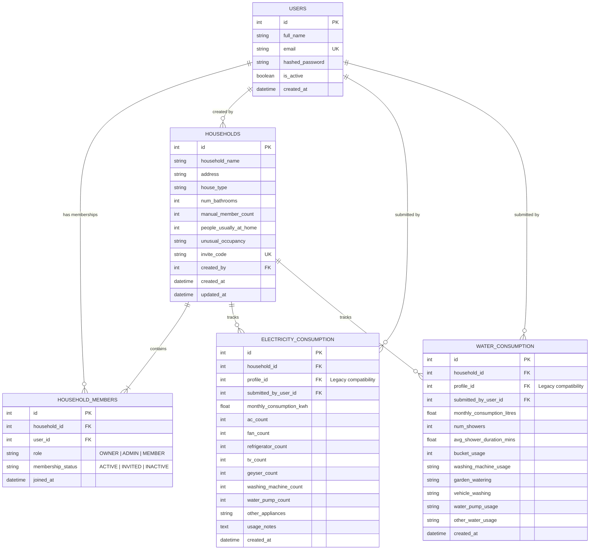

# AquaWatt — Phase 6.1: Database and Household Architecture Design
## Multi-Member Household Management, Role-Based Access Control & Migration Architecture

**Project:** AquaWatt — Water and Electricity Tracking App (Final-Year College Major Project)  
**Location:** `C:\Users\hp\Water-Electricity-Tracking-App`  
**Git Branch:** `feature/auth-and-consumption-forms`  
**Phase:** 6.1 — Architecture Inspection & Design (No Code or Database Modifications Executed)  
**Date:** November 15, 2026  
**Status:** **PROPOSED — AWAITING USER APPROVAL**  

---

## Executive Summary

Phase 1 through Phase 5 established AquaWatt's foundational infrastructure:
1. **Phase 1:** Core FastAPI backend with PostgreSQL, user registration/login with bcrypt and JWT, and an 8-screen liquid-glass Kivy/KivyMD mobile frontend.
2. **Phases 2–4:** Acquisition, cleaning, chronological train/validation/test splitting, and evaluation of real machine-learning benchmark datasets (UCI Electricity and HSB Living Lab Water).
3. **Phase 5:** Backend ML integration with dedicated autoregressive inference services, strict validation rules, dual-environment artifact configuration (`deployment` vs `evaluation`), and a complete 26-test verification suite.

In the current Phase 1 implementation, household tracking is tied strictly **1-to-1** between a single user and a single `HouseholdProfile`. This design limits real-world utility:
- Multiple family members, roommates, or co-tenants living in the same home cannot collaboratively track utility consumption.
- If a spouse or flatmate registers, they must create a separate disconnected profile, duplicating household records.
- Consumption entries do not record *which* individual logged the bill or meter reading.

**Phase 6.1 introduces a comprehensive architectural design** to transition AquaWatt into a **multi-member household collaboration platform**. This document details the proposed database schema, role-based access control (RBAC), existing-data migration strategy, API impacts, testing strategy, and risk analysis.

> [!IMPORTANT]
> **Safety and Scope Commitment:**  
> This document represents an architectural proposal and codebase inspection only. **Zero application code, database schemas, migration scripts, or existing records have been modified.** Implementation will begin only upon formal approval.

---

## 1. Current Architecture Findings & Codebase Audit

An inspection of the PostgreSQL database, SQLAlchemy models, Pydantic schemas, and API routes was conducted without altering any files or records.

### 1.1 Existing Database Tables & Record Inventory

The active PostgreSQL database contains **four tables** with zero orphaned foreign-key references:

| Table Name | Active Records | Primary Key | Foreign Keys | Constraints & Indexes |
| :--- | :---: | :--- | :--- | :--- |
| `users` | **165** | `id` (INTEGER, PK) | None | `ix_users_email` (UNIQUE), `ix_users_id` |
| `household_profiles` | **80** | `id` (INTEGER, PK) | `user_id` -> `users.id` (`ON DELETE CASCADE`) | `household_profiles_user_id_key` (UNIQUE), `ix_household_profiles_id` |
| `electricity_consumption` | **101** | `id` (INTEGER, PK) | `profile_id` -> `household_profiles.id` (`ON DELETE CASCADE`) | `ix_electricity_consumption_profile_id`, `ix_electricity_consumption_id` |
| `water_consumption` | **100** | `id` (INTEGER, PK) | `profile_id` -> `household_profiles.id` (`ON DELETE CASCADE`) | `ix_water_consumption_profile_id`, `ix_water_consumption_id` |

* **Orphan Check:** SQL integrity queries confirmed `0` orphaned profiles, `0` orphaned electricity records, and `0` orphaned water records.
* **Sensitive Configuration:** Database credentials, JWT secrets, and password hashes were kept strictly confidential and omitted from this report.

### 1.2 Current Entity Relationships

The current entity relationship is strictly linear:

```text
User (1)  <--------[1-to-1]-------->  (1) HouseholdProfile
                                              |
                                              +----[1-to-Many]----> ElectricityConsumption
                                              |
                                              +----[1-to-Many]----> WaterConsumption
```

### 1.3 Identified Architectural Limitations of the Existing Design

1. **Strict 1-to-1 Coupling:** `household_profiles.user_id` has a `UNIQUE` constraint. A user can belong to at most one profile, and a profile can belong to exactly one user. Multiple household residents cannot share the same tracking dashboard.
2. **Missing Authorship Metadata:** Neither `electricity_consumption` nor `water_consumption` contains a `user_id` or `submitted_by` column. If multiple residents were to share a profile, it would be impossible to identify who submitted a specific entry.
3. **Rigid API Scoping:** In `backend/app/routes/consumption.py`, queries resolve records strictly via:
   ```python
   profile = db.query(HouseholdProfile).filter(HouseholdProfile.user_id == current_user.id).first()
   records = db.query(ElectricityConsumption).filter(ElectricityConsumption.profile_id == profile.id).all()
   ```
   This assumes the authenticated user is the sole owner and member of that profile.
4. **Absence of a Formal Migration System:**
   - Database tables are currently initialized using `Base.metadata.create_all(bind=engine)` inside the FastAPI `lifespan` handler (`backend/app/main.py`).
   - `create_all` only creates tables that do not yet exist; **it cannot add columns, modify constraints, or alter existing tables.**
   - Alembic is neither installed nor configured in `backend/requirements.txt`.
   - Modifying tables in production without Alembic risks accidental table recreation and data loss.

---

## 2. Proposed Entity Relationship Diagram (ERD)

The proposed architecture introduces two new central entities: **`Household`** (the dwelling/home unit) and **`HouseholdMember`** (the associative membership entity connecting users to households with role permissions).



---

## 3. Proposed SQLAlchemy Model Structure

The proposed models preserve the existing conventions (SQLAlchemy 2.0 declarative syntax, `Base` inheritance, explicit table names, indexing).

### 3.1 `Household` Model (`backend/app/models/household.py`)

```python
from sqlalchemy import Column, DateTime, ForeignKey, Integer, String, func
from sqlalchemy.orm import relationship
from database import Base


class Household(Base):
    __tablename__ = "households"

    id = Column(Integer, primary_key=True, index=True)
    household_name = Column(String(100), nullable=False)
    address = Column(String(255), nullable=False)  # Maps from legacy HouseholdProfile.location
    house_type = Column(String(50), nullable=False)  # Apartment, Independent House, Villa, etc.
    num_bathrooms = Column(Integer, nullable=False, default=1)

    # Demographic & Occupancy Normalization Fields
    # Note: manual_member_count represents the total human occupancy in the house (including children
    # and elderly who may not have user accounts), used for per-person LPCD and kWh normalization.
    manual_member_count = Column(Integer, nullable=False, default=1)
    people_usually_at_home = Column(Integer, nullable=True)
    unusual_occupancy = Column(String(50), default="None", nullable=True)

    # Unique 8-character alphanumeric invite code for simple mobile joining (e.g., 'AQ-78K2P9')
    invite_code = Column(String(16), unique=True, index=True, nullable=False)

    created_by = Column(Integer, ForeignKey("users.id", ondelete="SET NULL"), nullable=True, index=True)
    created_at = Column(DateTime(timezone=True), server_default=func.now(), nullable=False)
    updated_at = Column(DateTime(timezone=True), server_default=func.now(), onupdate=func.now(), nullable=False)

    # Relationships
    creator = relationship("User", foreign_keys=[created_by], back_populates="created_households")
    memberships = relationship(
        "HouseholdMember",
        back_populates="household",
        cascade="all, delete-orphan",
        order_by="HouseholdMember.joined_at.asc()"
    )
    electricity_records = relationship(
        "ElectricityConsumption",
        back_populates="household",
        cascade="all, delete-orphan",
        order_by="desc(ElectricityConsumption.created_at)"
    )
    water_records = relationship(
        "WaterConsumption",
        back_populates="household",
        cascade="all, delete-orphan",
        order_by="desc(WaterConsumption.created_at)"
    )
```

### 3.2 `HouseholdMember` Model (`backend/app/models/household_member.py`)

```python
import enum
from sqlalchemy import Column, DateTime, Enum, ForeignKey, Integer, String, UniqueConstraint, func
from sqlalchemy.orm import relationship
from database import Base


class MemberRole(str, enum.Enum):
    OWNER = "OWNER"
    ADMIN = "ADMIN"
    MEMBER = "MEMBER"


class MembershipStatus(str, enum.Enum):
    ACTIVE = "ACTIVE"
    INVITED = "INVITED"
    INACTIVE = "INACTIVE"


class HouseholdMember(Base):
    __tablename__ = "household_members"

    id = Column(Integer, primary_key=True, index=True)
    household_id = Column(Integer, ForeignKey("households.id", ondelete="CASCADE"), nullable=False, index=True)
    user_id = Column(Integer, ForeignKey("users.id", ondelete="CASCADE"), nullable=False, index=True)

    role = Column(String(20), default=MemberRole.MEMBER.value, nullable=False)
    membership_status = Column(String(20), default=MembershipStatus.ACTIVE.value, nullable=False)
    joined_at = Column(DateTime(timezone=True), server_default=func.now(), nullable=False)

    # Constraints: A user can only have one active membership per household
    __table_args__ = (
        UniqueConstraint("household_id", "user_id", name="uq_household_member"),
    )

    # Relationships
    household = relationship("Household", back_populates="memberships")
    user = relationship("User", back_populates="household_memberships")
```

### 3.3 Additions to `User` Model (`backend/app/models/user.py`)

```python
# Add to existing User model:
class User(Base):
    # ... existing fields (id, full_name, email, hashed_password, is_active, created_at) ...

    # Existing 1-to-1 legacy relationship preserved for backward compatibility
    profile = relationship("HouseholdProfile", back_populates="user", uselist=False, cascade="all, delete-orphan")

    # New multi-household relationships
    created_households = relationship("Household", foreign_keys="Household.created_by", back_populates="creator")
    household_memberships = relationship("HouseholdMember", back_populates="user", cascade="all, delete-orphan")
    submitted_electricity_records = relationship("ElectricityConsumption", back_populates="submitted_by")
    submitted_water_records = relationship("WaterConsumption", back_populates="submitted_by")
```

### 3.4 Updates to `ElectricityConsumption` and `WaterConsumption`

Both consumption models receive two new columns:
1. `household_id`: Linking the record directly to the new `Household`.
2. `submitted_by_user_id`: Storing the exact user who recorded the entry.
3. The legacy `profile_id` column is **retained as nullable** to ensure existing queries and tests never break.

```python
# In ElectricityConsumption:
household_id = Column(Integer, ForeignKey("households.id", ondelete="CASCADE"), nullable=True, index=True)
submitted_by_user_id = Column(Integer, ForeignKey("users.id", ondelete="SET NULL"), nullable=True, index=True)

# Relationships
household = relationship("Household", back_populates="electricity_records")
submitted_by = relationship("User", back_populates="submitted_electricity_records")

# In WaterConsumption:
household_id = Column(Integer, ForeignKey("households.id", ondelete="CASCADE"), nullable=True, index=True)
submitted_by_user_id = Column(Integer, ForeignKey("users.id", ondelete="SET NULL"), nullable=True, index=True)

# Relationships
household = relationship("Household", back_populates="water_records")
submitted_by = relationship("User", back_populates="submitted_water_records")
```

---

## 4. Keys, Constraints, and Indexes Reference

| Table | Column / Constraint | Type | Role & Rationale |
| :--- | :--- | :--- | :--- |
| **`households`** | `id` | PK (INTEGER) | Surrogate primary key. |
| | `invite_code` | UNIQUE, INDEX | Quick lookup when members join via mobile invite code. |
| | `created_by` | FK -> `users.id` | `ON DELETE SET NULL` prevents destroying a household if the founding user leaves. |
| **`household_members`** | `id` | PK (INTEGER) | Surrogate primary key. |
| | `household_id` | FK -> `households.id` | `ON DELETE CASCADE`: Deleting a household cleans up all membership rows. |
| | `user_id` | FK -> `users.id` | `ON DELETE CASCADE`: Deleting a user cleans up their membership entries. |
| | `uq_household_member` | UNIQUE (`household_id`, `user_id`) | **Prevents duplicate membership:** A user cannot join the same household twice. |
| | `ix_household_members_user_id` | INDEX | Optimizes resolving all households a user belongs to. |
| | `ix_household_members_household_id` | INDEX | Optimizes retrieving all members in a given household. |
| **`electricity_consumption`** | `household_id` | FK -> `households.id` | `ON DELETE CASCADE`: Links consumption to the household entity. |
| | `submitted_by_user_id` | FK -> `users.id` | `ON DELETE SET NULL`: Records author; preserves utility data if member leaves. |
| | `ix_elec_household_created` | COMPOSITE INDEX (`household_id`, `created_at` DESC) | High-performance fetching of recent history and summary trends. |
| **`water_consumption`** | `household_id` | FK -> `households.id` | `ON DELETE CASCADE`: Links consumption to the household entity. |
| | `submitted_by_user_id` | FK -> `users.id` | `ON DELETE SET NULL`: Records author; preserves utility data if member leaves. |
| | `ix_water_household_created` | COMPOSITE INDEX (`household_id`, `created_at` DESC) | High-performance fetching of recent history and summary trends. |

---

## 5. Household Membership & Role Permissions (RBAC Matrix)

Three roles are defined with clear boundaries:
- **`OWNER`**: The household founder or designated successor. Holds ultimate administrative authority.
- **`ADMIN`**: Co-managers (e.g., spouse, elder roommate). Can manage dwelling settings and invite members.
- **`MEMBER`**: General residents. Can view all household data and submit new consumption records.

| Action / Capability | `OWNER` | `ADMIN` | `MEMBER` | Non-Member / Other |
| :--- | :---: | :---: | :---: | :---: |
| **View Household Dashboard & Analytics** | Allowed | Allowed | Allowed | **403 Forbidden** |
| **View Shared Consumption History (Water & Electricity)** | Allowed | Allowed | Allowed | **403 Forbidden** |
| **Submit New Consumption Reading** | Allowed | Allowed | Allowed | **403 Forbidden** |
| **Edit/Delete Own Submitted Reading** | Allowed | Allowed | Allowed | **403 Forbidden** |
| **Delete Other Member's Submitted Reading** | Allowed | Allowed | Denied | **403 Forbidden** |
| **Edit Household Physical Details (Address, Rooms, etc.)** | Allowed | Allowed | Denied | **403 Forbidden** |
| **Generate / View Invite Code** | Allowed | Allowed | Denied | **403 Forbidden** |
| **Invite New Member via Email/Code** | Allowed | Allowed | Denied | **403 Forbidden** |
| **Remove Regular Member (`MEMBER`)** | Allowed | Allowed | Denied | **403 Forbidden** |
| **Remove Admin (`ADMIN`)** | Allowed | Denied | Denied | **403 Forbidden** |
| **Promote Member to Admin / Demote Admin** | Allowed | Denied | Denied | **403 Forbidden** |
| **Transfer Ownership (`OWNER` role)** | Allowed | Denied | Denied | **403 Forbidden** |
| **Delete Entire Household** | Allowed | Denied | Denied | **403 Forbidden** |
| **Leave Household (Self-Removal)** | Only after transferring ownership | Allowed | Allowed | N/A |

---

## 6. Important Architectural Decisions & Recommendations

### 6.1 Single vs Multiple Household Memberships
* **Question:** Should a user initially belong to only one household, or should multiple household memberships be supported?
* **Recommendation:**
  * **Database Level:** The schema is fully many-to-many (`HouseholdMember` links `user_id` to `household_id`). It naturally supports multiple households without future DDL changes.
  * **Application / UI Level:** In Phase 6, the API defaults to resolving the user's primary/active household. If a user belongs to one household, all calls default to it. If a user belongs to multiple households, an optional query param `?household_id=X` or an active household session indicator resolves the context.
  * **Benefit:** Gives maximum future extensibility (e.g., student with a college flat and a family home) while keeping the initial mobile flow simple.

### 6.2 Existing `HouseholdProfile` Migration
* **Question:** How should existing `HouseholdProfile` data be migrated into the new structure?
* **Recommendation:**
  * Each of the **80 existing `HouseholdProfile` records** is migrated directly into a new `Household` record.
  * The profile's `user_id` becomes `households.created_by`.
  * The household name is auto-generated as `"{user.full_name}'s Household"`.
  * An associated `HouseholdMember` record is created linking `(household_id, user_id)` with `role='OWNER'`.
  * Existing electricity and water records are backfilled with `household_id = new_household.id` and `submitted_by_user_id = profile.user_id`.
  * The `household_profiles` table is retained as a compatibility view/table during Phase 6 so older client versions or scripts do not crash.

### 6.3 Household Settings Authorization
* **Question:** Should household settings be editable only by owners/admins?
* **Recommendation:**
  * **YES.** Physical house parameters (`num_bathrooms`, `house_type`, `manual_member_count`, `address`) directly affect per-person normalization and target metrics.
  * Modifying these settings requires `OWNER` or `ADMIN` role. Regular `MEMBER` users attempting to update household settings will receive `403 Forbidden`.

### 6.4 Shared Consumption Visibility
* **Question:** Should all household members be able to view shared water and electricity consumption?
* **Recommendation:**
  * **YES.** Collaborative resource tracking is the primary goal of Phase 6. Every active member of the household should see the collective billing history, recent consumption trends, and summary metrics.

### 6.5 Consumption Record Authorship
* **Question:** How should the system identify which member submitted a consumption record?
* **Recommendation:**
  * Explicit `submitted_by_user_id` foreign key on both `electricity_consumption` and `water_consumption`.
  * Automatically populated from `current_user.id` by the API route on record creation.
  * Configured with `ON DELETE SET NULL`: If the user later leaves or deletes their account, the historical consumption data remains attached to the household with `submitted_by = NULL`.

### 6.6 Owner Departure & Account Deletion Safeguards
* **Question:** What should happen if an owner leaves or deletes their account?
* **Recommendation:**
  * **Invariable Rule:** A household must always have exactly one active `OWNER`.
  * **Case 1 (Sole Member):** If the owner is the only member and deletes their account, the household and its consumption records are deleted (`CASCADE`) or archived.
  * **Case 2 (Multi-Member Household):** The owner **cannot** leave or delete their account while other members remain without first transferring ownership to an `ADMIN` or `MEMBER`.
  * **Case 3 (System Deletion / Fallback):** If an owner account is forcefully deleted by an admin action, the system automatically promotes the oldest `ADMIN` (by `joined_at`), or the oldest `MEMBER`, to `OWNER`.

### 6.7 Preventing Cross-Household Tenant Data Leaks
* **Question:** How can we prevent users from accessing another household's records?
* **Recommendation:**
  * Enforce authorization through a reusable FastAPI dependency:
    ```python
    def require_household_member(
        household_id: int,
        required_role: Optional[MemberRole] = None,
        current_user: User = Depends(get_current_user),
        db: Session = Depends(get_db)
    ) -> HouseholdMember:
        member = db.query(HouseholdMember).filter(
            HouseholdMember.household_id == household_id,
            HouseholdMember.user_id == current_user.id,
            HouseholdMember.membership_status == "ACTIVE"
        ).first()
        if not member:
            raise HTTPException(status_code=403, detail="You do not have access to this household.")
        if required_role and not has_sufficient_permission(member.role, required_role):
            raise HTTPException(status_code=403, detail="Insufficient household permissions.")
        return member
    ```
  * Every endpoint accessing or modifying household data invokes this dependency.

### 6.8 Interaction with Existing Authentication
* **Question:** How should the existing authentication system work with household membership?
* **Recommendation:**
  * The JWT authentication system remains **100% unchanged**. Tokens authenticate the `User` identity via `sub=user.id`.
  * Authentication answers *"Who is the user?"*.
  * Household authorization answers *"Which households can this user access, and what are their permissions?"*.
  * The login and registration response payload (`TokenResponse`) is augmented with an optional `active_household_id: Optional[int]` and `has_household: bool` flag to help the frontend navigate smoothly.

---

## 7. Backward Compatibility & Existing-Data Migration Strategy

### 7.1 Introducing Alembic Safely

The existing project relies on `Base.metadata.create_all(bind=engine)` inside `lifespan` in `backend/app/main.py`. This method cannot perform schema alterations.

**Safe 4-Step Process to Introduce Alembic Without Data Loss:**
1. **Add Dependency:** Add `alembic>=1.13.0` to `backend/requirements.txt` and install in `.venv`.
2. **Initialize Migration Directory:** Execute `alembic init backend/alembic`.
3. **Configure `env.py`:** Bind Alembic to `Base.metadata` from `backend/app/database.py` and dynamically read `DATABASE_URL`.
4. **Baseline Stamping (Crucial):** Generate an initial migration representing the current 4 tables (`users`, `household_profiles`, `electricity_consumption`, `water_consumption`), and run `alembic stamp head`. This marks the existing live database as up-to-date without attempting to re-execute table creation.

### 7.2 Phase 6 Migration Script Structure

A single, atomic Alembic migration script (`xxxx_add_household_and_members.py`) will execute the transition:

```python
"""Add households and household_members with full data backfill

Revision ID: 0002_add_household_architecture
Revises: 0001_baseline
"""
from alembic import op
import sqlalchemy as sa
import secrets

def upgrade():
    # 1. Create 'households' table
    op.create_table(
        'households',
        sa.Column('id', sa.Integer(), primary_key=True),
        sa.Column('household_name', sa.String(100), nullable=False),
        sa.Column('address', sa.String(255), nullable=False),
        sa.Column('house_type', sa.String(50), nullable=False),
        sa.Column('num_bathrooms', sa.Integer(), nullable=False, server_default='1'),
        sa.Column('manual_member_count', sa.Integer(), nullable=False, server_default='1'),
        sa.Column('people_usually_at_home', sa.Integer(), nullable=True),
        sa.Column('unusual_occupancy', sa.String(50), nullable=True, server_default='None'),
        sa.Column('invite_code', sa.String(16), nullable=False),
        sa.Column('created_by', sa.Integer(), sa.ForeignKey('users.id', ondelete='SET NULL'), nullable=True),
        sa.Column('created_at', sa.DateTime(timezone=True), server_default=sa.func.now(), nullable=False),
        sa.Column('updated_at', sa.DateTime(timezone=True), server_default=sa.func.now(), nullable=False),
    )
    op.create_index('ix_households_invite_code', 'households', ['invite_code'], unique=True)
    op.create_index('ix_households_created_by', 'households', ['created_by'])

    # 2. Create 'household_members' table
    op.create_table(
        'household_members',
        sa.Column('id', sa.Integer(), primary_key=True),
        sa.Column('household_id', sa.Integer(), sa.ForeignKey('households.id', ondelete='CASCADE'), nullable=False),
        sa.Column('user_id', sa.Integer(), sa.ForeignKey('users.id', ondelete='CASCADE'), nullable=False),
        sa.Column('role', sa.String(20), nullable=False, server_default='MEMBER'),
        sa.Column('membership_status', sa.String(20), nullable=False, server_default='ACTIVE'),
        sa.Column('joined_at', sa.DateTime(timezone=True), server_default=sa.func.now(), nullable=False),
        sa.UniqueConstraint('household_id', 'user_id', name='uq_household_member')
    )
    op.create_index('ix_household_members_household_id', 'household_members', ['household_id'])
    op.create_index('ix_household_members_user_id', 'household_members', ['user_id'])

    # 3. Add new columns to electricity_consumption and water_consumption (nullable initially)
    op.add_column('electricity_consumption', sa.Column('household_id', sa.Integer(), nullable=True))
    op.add_column('electricity_consumption', sa.Column('submitted_by_user_id', sa.Integer(), nullable=True))
    op.create_foreign_key('fk_elec_household', 'electricity_consumption', 'households', ['household_id'], ['id'], ondelete='CASCADE')
    op.create_foreign_key('fk_elec_submitted_by', 'electricity_consumption', 'users', ['submitted_by_user_id'], ['id'], ondelete='SET NULL')

    op.add_column('water_consumption', sa.Column('household_id', sa.Integer(), nullable=True))
    op.add_column('water_consumption', sa.Column('submitted_by_user_id', sa.Integer(), nullable=True))
    op.create_foreign_key('fk_water_household', 'water_consumption', 'households', ['household_id'], ['id'], ondelete='CASCADE')
    op.create_foreign_key('fk_water_submitted_by', 'water_consumption', 'users', ['submitted_by_user_id'], ['id'], ondelete='SET NULL')

    # 4. Deterministic Backfill of Existing 80 HouseholdProfiles
    connection = op.get_bind()
    profiles = connection.execute(sa.text("""
        SELECT hp.id, hp.user_id, hp.household_members, hp.house_type, hp.location,
               hp.num_bathrooms, hp.people_usually_at_home, hp.unusual_occupancy,
               hp.created_at, hp.updated_at, u.full_name
        FROM household_profiles hp
        JOIN users u ON hp.user_id = u.id
    """)).fetchall()

    for p in profiles:
        invite_code = f"AQ-{secrets.token_hex(3).upper()}"
        # Insert into households (using profile id directly to keep mapping 1:1)
        connection.execute(sa.text("""
            INSERT INTO households (
                id, household_name, address, house_type, num_bathrooms,
                manual_member_count, people_usually_at_home, unusual_occupancy,
                invite_code, created_by, created_at, updated_at
            ) VALUES (
                :id, :name, :address, :house_type, :num_bathrooms,
                :members, :people_at_home, :occupancy,
                :invite_code, :user_id, :created_at, :updated_at
            )
        """), {
            "id": p.id,
            "name": f"{p.full_name}'s Household",
            "address": p.location,
            "house_type": p.house_type,
            "num_bathrooms": p.num_bathrooms,
            "members": p.household_members,
            "people_at_home": p.people_usually_at_home,
            "occupancy": p.unusual_occupancy or "None",
            "invite_code": invite_code,
            "user_id": p.user_id,
            "created_at": p.created_at,
            "updated_at": p.updated_at
        })

        # Insert membership with OWNER role
        connection.execute(sa.text("""
            INSERT INTO household_members (household_id, user_id, role, membership_status, joined_at)
            VALUES (:household_id, :user_id, 'OWNER', 'ACTIVE', :joined_at)
        """), {
            "household_id": p.id,
            "user_id": p.user_id,
            "joined_at": p.created_at
        })

    # Update sequence for households table so future inserts increment properly
    connection.execute(sa.text("SELECT setval(pg_get_serial_sequence('households', 'id'), coalesce(max(id), 1)) FROM households"))

    # 5. Backfill consumption records
    connection.execute(sa.text("""
        UPDATE electricity_consumption ec
        SET household_id = ec.profile_id,
            submitted_by_user_id = hp.user_id
        FROM household_profiles hp
        WHERE ec.profile_id = hp.id
    """))

    connection.execute(sa.text("""
        UPDATE water_consumption wc
        SET household_id = wc.profile_id,
            submitted_by_user_id = hp.user_id
        FROM household_profiles hp
        WHERE wc.profile_id = hp.id
    """))

    # 6. Make household_id non-nullable now that data is populated
    op.alter_column('electricity_consumption', 'household_id', nullable=False)
    op.alter_column('water_consumption', 'household_id', nullable=False)
```

### 7.3 Backward Compatibility Shims (Zero Downtime)
- **API Facade for `/profile`:** The existing `/profile` endpoints (`GET` and `POST`) will remain active. They will internally resolve the user's primary household, acting as a compatibility wrapper for existing mobile screens.
- **Dual References in Consumption Models:** Retaining `profile_id` ensures any code or test referencing `record.profile_id` continues to execute successfully without deprecation breakage.

---

## 8. API Impact Analysis & Proposed Endpoints

### 8.1 Existing Endpoints & Required Adjustments

| Existing Endpoint | Impact / Modification Required | Backward Compatibility Status |
| :--- | :--- | :--- |
| `POST /auth/register` | No change. | 100% Compatible |
| `POST /auth/login` | Augmented response: adds `active_household_id`. | 100% Compatible |
| `GET /auth/me` | Augmented response: adds list of household memberships. | 100% Compatible |
| `GET /profile` | Maps internally to `GET /households/{primary_id}`. | 100% Compatible (Facade) |
| `POST /profile` | Creates or updates user's primary household. | 100% Compatible (Facade) |
| `POST /consumption/electricity` | Sets both `household_id` and `submitted_by_user_id`. | 100% Compatible |
| `GET /consumption/electricity` | Filters by user's active `household_id`. | 100% Compatible |
| `POST /consumption/water` | Sets both `household_id` and `submitted_by_user_id`. | 100% Compatible |
| `GET /consumption/water` | Filters by user's active `household_id`. | 100% Compatible |
| `GET /consumption/summary` | Computes metrics for user's active `household_id`. | 100% Compatible |
| `POST /ml/predict/*` | Independent benchmark service. No changes required. | 100% Compatible |
| `GET /ml/status` | Diagnostic service. No changes required. | 100% Compatible |

### 8.2 Proposed New Household Management Endpoints (`backend/app/routes/households.py`)

```text
Households API Router (/households):
├── POST   /households                          Create a new household (creator becomes OWNER)
├── GET    /households                          List all households the authenticated user belongs to
├── GET    /households/{id}                     Retrieve details, members, and summary of a specific household
├── PUT    /households/{id}                     Update household dwelling settings (OWNER or ADMIN only)
├── DELETE /households/{id}                     Delete entire household (OWNER only)
├── POST   /households/join                     Join a household using an invite_code
├── POST   /households/{id}/invite-code/rotate  Regenerate invite code (OWNER or ADMIN only)
├── GET    /households/{id}/members             List all members with roles and join dates
├── POST   /households/{id}/members             Add a member directly by email (OWNER or ADMIN)
├── PUT    /households/{id}/members/{user_id}   Update member role (OWNER only)
├── DELETE /households/{id}/members/{user_id}   Remove a member, or leave household (Self)
└── POST   /households/{id}/transfer-owner      Transfer OWNER role to another active member (OWNER only)
```

---

## 9. Comprehensive Testing Strategy

A dedicated test module (`backend/tests/test_household_architecture.py`) will be implemented alongside existing test suites:

1. **Household Creation & Ownership:**
   - Verify creating a household automatically grants `OWNER` role to the creator in `household_members`.
   - Verify invite code is automatically generated and formatted (`AQ-XXXXXX`).
2. **Membership & Joining Flow:**
   - Verify a second authenticated user can join via `POST /households/join` using the valid invite code.
   - Verify joining with an invalid or expired invite code returns `404 Not Found`.
3. **Duplicate Membership Prevention:**
   - Attempt to add an already existing member to the same household; verify the `UniqueConstraint("household_id", "user_id")` or API validation rejects with `400 Bad Request` or `409 Conflict`.
4. **Role-Based Access Control (RBAC):**
   - Verify regular `MEMBER` cannot edit household settings (assert `403 Forbidden`).
   - Verify `ADMIN` can update address and member counts, but cannot delete the household or transfer ownership.
   - Verify only `OWNER` can demote an admin or delete the household.
5. **Cross-Household Tenant Isolation:**
   - Create User A (Household 1) and User B (Household 2).
   - Have User B attempt to read `GET /households/{household_1_id}` or `GET /consumption/summary?household_id={household_1_id}`.
   - Assert immediate rejection with `403 Forbidden`.
6. **Shared Consumption Collaboration:**
   - User A logs an electricity record; verify User B (in the same household) sees the record in their history and summary.
   - Verify `submitted_by_user_id` accurately reflects User A.
7. **Owner Succession & Departure:**
   - Verify an owner cannot leave the household without transferring ownership when other members exist.
   - Verify successful transfer of `OWNER` role to an `ADMIN`.
8. **Backward Compatibility Verification:**
   - Run the complete existing test suite (`test_api.py` and `test_ml_endpoints.py`).
   - Assert all **26 existing tests continue to pass 100%** without any regressions.

---

## 10. Risks & Mitigation Plan

| Identified Risk | Severity | Potential Impact | Mitigation Strategy |
| :--- | :---: | :--- | :--- |
| **Data Loss During Table Alteration** | Critical | Existing 80 profiles or 201 consumption records could be lost if tables are dropped. | **Never drop tables.** Use Alembic baseline stamping, add nullable columns first, backfill data deterministically, then enforce constraints. |
| **Alembic Configuration Conflicts** | High | Misconfigured database connection could corrupt development DB. | Isolate migration scripts; verify connection string dynamically from environment variables; test migration on a backup first. |
| **Mobile UI Desynchronization** | Medium | Mobile app expecting old `/profile` endpoints could fail to load dashboard. | Implement `/profile` as an internal proxy to the household API. The mobile app can be upgraded incrementally in Phase 6.5. |
| **Cross-Tenant Data Leakage** | High | A user viewing another family's utility bills or location details. | Mandatory dependency `require_household_member` applied to every router endpoint. Strict database-level filtering on `household_id`. |
| **Orphaned Consumption History** | Medium | A user deleting their account could cascade-delete shared household bills. | Configure `submitted_by_user_id` with `ON DELETE SET NULL`. The bill remains part of the household's permanent record. |

---

## 11. Recommended Implementation Order (Phased Roadmap)

```text
[Phase 6.1: Architecture Design & Inspection] <--- WE ARE HERE (Deliverable Complete)
       │
       ▼ (Awaiting User Approval)
[Phase 6.2: Alembic Setup & Migration Execution]
       │  • Install Alembic in backend/.venv
       │  • Stamp existing 4 tables as baseline
       │  • Write and execute migration script with backfill of 80 profiles
       │  • Verify database integrity (0 data loss, 0 orphans)
       ▼
[Phase 6.3: Backend Model & Service Layer Implementation]
       │  • Add Household and HouseholdMember SQLAlchemy models
       │  • Implement RBAC authorization dependencies
       │  • Update consumption models with household_id and submitted_by_user_id
       ▼
[Phase 6.4: REST API Endpoints & Backward Compatibility Testing]
       │  • Create /households routes (CRUD, invite codes, member management)
       │  • Adapt /consumption routes to support household filtering
       │  • Maintain /profile compatibility facade
       │  • Run full test suite (ensure 26/26 existing tests + new household tests pass)
       ▼
[Phase 6.5: Mobile Frontend Integration (Kivy/KivyMD)]
          • Add Household Management UI & Member Invitation Screen
          • Display household member list and invite code
          • Adapt consumption dashboard to display household name and submitter avatars
```

---

## 12. Decisions Requiring User Approval

Before any code or database changes are made, please review and approve the following design decisions:

1. **Invite Code Mechanism:** Do you approve using an alphanumeric join code (e.g., `AQ-78K2P9`) generated for each household to allow family members to join via the mobile app?
2. **Role Hierarchy:** Do you approve the 3-tier role hierarchy: `OWNER`, `ADMIN`, and `MEMBER`?
3. **Alembic Introduction:** Do you approve adding Alembic to manage this and all future database migrations safely?
4. **Backward Compatibility Facade:** Do you approve keeping `/profile` active as an internal proxy so existing Kivy screens continue working without immediate breaking changes?
5. **Proceed to Phase 6.2:** Do you approve proceeding to Phase 6.2 (Alembic configuration and schema migration preparation)?

---

*Report prepared and verified by Antigravity System Agent. Codebase and database integrity confirmed unchanged.*

