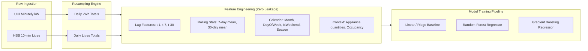

# AquaWatt Machine Learning Dataset Research & Verification Report
## Comprehensive Analysis of Benchmark Datasets for Household Utility Forecasting

**Document:** `machine_learning/DATASET_RESEARCH.md`  
**Revision:** 2.0 (Corrected & Verified)  
**Date:** November 15, 2026  
**Project:** AquaWatt — Water and Electricity Tracking App (Final-Year Major Project)  
**Status:** Verification Completed — Awaiting User Approval Prior to Ingestion

---

## 1. Executive Summary & Research Mandate

AquaWatt requires authentic, publicly verifiable, peer-reviewed empirical datasets to build its machine learning forecasting subsystem. 

### Core Ethical & Methodological Rules
1. **Zero Synthetic / Invented Data:** No artificial, fabricated, or LLM-generated consumption numbers will be presented as empirical meter data.
2. **Strict Provenance & Verification:** Every dataset must have verifiable digital object identifiers (DOIs), clear open licensing (e.g., CC BY 4.0), documented measurement hardware, and known missing-data distributions.
3. **No Premature Training Claims:** Models will not be described as trained until verified raw datasets are downloaded, preprocessed, and evaluated through chronological cross-validation.
4. **Geographical & Contextual Transparency:** Any geographical, infrastructural, or climatic disparities between the training data origin (e.g., Europe) and the deployment target (urban households in India) must be explicitly documented and methodologically addressed.

---

## 2. Electricity Dataset: UCI Individual Household Electric Power Consumption

### 2.1 Provenance & Official Source
* **Dataset Title:** *Individual Household Electric Power Consumption*
* **Creators / Authors:** Georges Hébrail and Alice Bérard (Électricité de France [EDF] R&D, Clamart, France).
* **Official Repository:** UCI Machine Learning Repository (Dataset ID: 235).
* **Official Persistent Identifier (DOI):** [https://doi.org/10.24432/C58K54](https://doi.org/10.24432/C58K54)
* **Direct UCI Catalog Page:** [https://archive.ics.uci.edu/dataset/235/individual+household+electric+power+consumption](https://archive.ics.uci.edu/dataset/235/individual+household+electric+power+consumption)
* **Direct Archive Download URL:** [https://archive.ics.uci.edu/static/public/235/individual+household+electric+power+consumption.zip](https://archive.ics.uci.edu/static/public/235/individual+household+electric+power+consumption.zip)
* **Formal Citation:**
  > Hébrail, G., & Bérard, A. (2012). *Individual Household Electric Power Consumption* [Dataset]. UCI Machine Learning Repository. https://doi.org/10.24432/C58K54.

### 2.2 License & Usage Permissions
* **License:** Creative Commons Attribution 4.0 International (**CC BY 4.0**).
* **Permissions:** Permits academic, educational, commercial, and derivative reuse, modification, and distribution, provided appropriate credit and citation are given.

### 2.3 Dataset Characteristics & Scale
* **Temporal Coverage:** **December 16, 2006, 17:24:00 to November 26, 2010, 21:02:00** (47 continuous calendar months / ~1,442 days).
* **Measurement Frequency:** Exact **1-minute sampling interval**.
* **Total Records:** **2,075,259 rows**.
* **Raw File Format:** Semicolon-delimited text (`household_power_consumption.txt`, ~126.8 MB uncompressed, ~20.6 MB ZIP archive).

### 2.4 Features & Measurement Units
The raw dataset contains 9 columns separated by semicolons (`;`):

| Column Name | Data Type | Measurement Unit | Description & Scope |
| :--- | :--- | :--- | :--- |
| `Date` | String | `dd/mm/yyyy` | Gregorian calendar date of measurement |
| `Time` | String | `hh:mm:ss` | UTC/Local time of measurement (1-minute resolution) |
| `Global_active_power` | Float | Kilowatts (kW) | Total household active power (minute-averaged) |
| `Global_reactive_power` | Float | Kilowatts (kW) | Total household reactive power (minute-averaged) |
| `Voltage` | Float | Volts (V) | Minute-averaged line voltage |
| `Global_intensity` | Float | Amperes (A) | Minute-averaged current intensity |
| `Sub_metering_1` | Float | Watt-hours (Wh) | Kitchen active energy (dishwasher, microwave, oven) |
| `Sub_metering_2` | Float | Watt-hours (Wh) | Laundry room energy (washing machine, dryer, fridge, light) |
| `Sub_metering_3` | Float | Watt-hours (Wh) | Climate control energy (electric water-heater and air-conditioner) |

### 2.5 Missing Data Distribution & Quality
* **Missing Value Representation:** Missing values are recorded as question marks (`?`) or consecutive semicolons (`;;`).
* **Missing Count:** **25,979 rows (approximately 1.25% of total measurements)**.
* **Missing Patterns:** Missing records are clustered in a few discrete equipment outages and power interruptions (e.g., late April to early May 2007, August 2009, and brief winter 2010 intervals).
* **Preprocessing Treatment:** Short gaps ($\le 5$ minutes) will be addressed with linear interpolation; longer multi-hour sensor interruptions will be imputed using the rolling median of the corresponding time-of-day from adjacent intact weeks to avoid distorting aggregate sums.

### 2.6 Critical Contextual Limitation: Single European Household
* **Single-Residence Scope:** The dataset originates from **exactly ONE single-family home** in Sceaux, Île-de-France (a southern suburb of Paris, France). It is **not** a cross-sectional multi-household survey.
* **Geographical & Climatic Contrast with Target Context (India):**
  * *Climate & Heating/Cooling:* Sceaux experiences a temperate oceanic climate (Köppen *Cfb*). Its energy peaks occur heavily in **winter** (December–February) driven by electric space heating and water geysers. In urban India (e.g., Delhi NCR, Bengaluru, Mumbai), residential peak demand occurs during **extreme summer heat** (April–July) dominated by multiple air conditioning units running continuously, alongside widespread ceiling fan use.
  * *Infrastructure & Voltage:* The European grid provides stable 230V continuous power. Urban Indian households frequently experience voltage fluctuations (requiring voltage stabilizers), diesel generator (DG) backup switches in high-rise apartments, and seasonal power cuts.
  * *Methodological Stance:* This dataset must be presented as a **technical benchmark for time-series feature engineering and sub-metered appliance regression**, not as an empirical representation of Indian residential habits.

---

## 3. Water Dataset: HSB Living Lab Fixture-Level Household Water Dataset

### 3.1 Provenance & Official Source
* **Dataset Title:** *HSB Living Lab Fixture-Level Household Water Consumption Dataset (2019–2023)*
* **Author / Principal Investigator:** Jesper Knutsson (Department of Architecture and Civil Engineering, Division of Water Environment Technology, Chalmers University of Technology, Gothenburg, Sweden).
* **Official Repository:** Zenodo (Open Research European Depository).
* **Official Persistent Identifier (DOI):** [https://doi.org/10.5281/zenodo.22076411](https://doi.org/10.5281/zenodo.22076411)
* **Direct Zenodo URL:** [https://zenodo.org/records/22076411](https://zenodo.org/records/22076411)
* **Direct Data Package URL:** [https://zenodo.org/records/22076411/files/HSB_Living_Lab_Data_Package.zip](https://zenodo.org/records/22076411/files/HSB_Living_Lab_Data_Package.zip)
* **Formal Citation:**
  > Knutsson, J. (2024). *HSB Living Lab Fixture-Level Household Water Consumption Dataset (2019–2023)* [Dataset]. Zenodo. https://doi.org/10.5281/zenodo.22076411.

### 3.2 License & Usage Permissions Verification
* **Official License:** Creative Commons Attribution 4.0 International (**CC BY 4.0**).
* **Verification Confirmation:** Explicitly designated and registered on Zenodo record `22076411`. Permits free redistribution, adaptation, and commercial/non-commercial use with required attribution.

### 3.3 Dataset Characteristics & Scale
* **Temporal Coverage:** **December 2019 to January 2023** (946 days / ~37 months with 83.9% temporal completeness).
* **Measurement Hardware & Resolution:** 214 high-precision pulse-counting water meters logging at **1-Litre volume resolution** at fixed **10-minute reporting intervals**.
* **Cross-Sectional Scale:** **28 residential apartments** arranged across **9 living clusters** (individual apartments and shared co-living researcher/student clusters).
* **Total Cleaned Records:** **652,315 observations**.
* **Aggregate Volume Measured:** **$3,271\text{ m}^3$** (approx. 3.27 million litres of potable water).
* **Included Data Package:** `HSB_Living_Lab_Data_Package.zip` contains:
  1. Cleaned fixture consumption time series (`.csv`).
  2. Complete variable metadata and data dictionary (`.pdf` / `.md`).
  3. Python/R cleaning and anonymization source scripts.
  4. Reproducibility code for peer-reviewed figures.

### 3.4 Features & Measurement Units
The dataset records water usage across hot and cold lines for 5 distinct domestic end-use categories:

| Column / Variable | Data Type | Measurement Unit | Description & Scope |
| :--- | :--- | :--- | :--- |
| `timestamp` | Datetime | ISO 8601 (`YYYY-MM-DD HH:MM:SS`) | Timestamp marking the end of the 10-minute logging window |
| `apartment_id` | Integer / String | Categorical (`Apt_1` to `Apt_28`) | Anonymized unique identifier for each residential unit |
| `cluster_id` | Integer / String | Categorical (`Cluster_1` to `9`) | Spatial grouping (co-living shared kitchen vs independent flat) |
| `fixture_type` | String | Categorical | Fixture: `shower`, `kitchen_tap`, `washbasin`, `toilet`, `laundry_dish` |
| `water_type` | String | Categorical | Supply line: `hot_water`, `cold_water` |
| `volume` | Float / Integer | Litres (L) | Water consumed in the 10-minute interval (1 pulse = 1 L) |

### 3.5 End-Use Breakdown in Dataset
According to Knutsson's empirical findings:
- **Showers:** Represent the single largest share of consumption (~**30.5%** of total residential volume), with high hot-water intensity.
- **Washbasins (Bathroom Sinks):** Account for ~**20.2%** of consumption.
- **Kitchen Taps:** Account for ~**18.7%** of consumption.
- **Toilets:** Account for ~**17.1%** of consumption.
- **Washing Machines & Dishwashers:** Account for ~**13.5%** of consumption.
- **Per-Capita Average:** Occupants consumed between **94 and 110 Litres/person/day (LPCD)**.

### 3.6 Critical Contextual Limitation: Swedish Modular Research Living Lab
* **Demographic Cohort:** The HSB Living Lab is inhabited primarily by Chalmers University students and visiting international researchers. While it provides authentic human behavior over 3 years, the occupants skew younger, more environmentally conscious, and more transient than long-term family households.
* **Geographical & Infrastructural Contrast with Target Context (India):**
  * *Supply Model:* Swedish residences receive continuous 24/7 pressurized municipal supply. In urban India, municipal supply is typically **intermittent** (1–2 hours in the morning and evening). Water is pumped from underground sumps to rooftop overhead tanks via electric booster pumps (which AquaWatt models in `water_pump_count` and `water_pump_usage`).
  * *Bathing Habits:* In India, **bucket baths** (consuming ~15–25 litres per bath) are widely practiced alongside or instead of long overhead showers (~60–100 litres per 8-minute shower).
  * *Filtration Reject:* Urban Indian households widely rely on domestic Reverse Osmosis (RO) purifiers, which reject 60–70% of feedwater as wastewater—a phenomenon absent in Sweden where tap water is directly potable.
  * *Methodological Stance:* The HSB Living Lab dataset provides an empirical fixture-level baseline that directly validates AquaWatt's form parameters (`num_showers`, `avg_shower_duration_mins`, `washing_machine_usage`), but regional calibration factors must be applied when generating conservation insights.

---

## 4. Forecasting Suitability & Comparative Evaluation

| Evaluation Criteria | UCI Electricity Dataset (E1) | HSB Living Lab Water Dataset (W1) |
| :--- | :--- | :--- |
| **Primary Target Metric** | Electric Energy Consumption ($kWh$) | Water Consumption ($Litres$ / $m^3$) |
| **Temporal Granularity** | 1 minute (high fidelity) | 10 minutes (medium-high fidelity) |
| **Temporal Duration** | 47 continuous months (Dec 2006 – Nov 2010) | 37 continuous months (Dec 2019 – Jan 2023) |
| **Sample Size** | 2,075,259 measurements | 652,315 measurements |
| **Cross-Sectional Breadth** | 1 household (pure longitudinal time-series) | 28 apartments (panel / longitudinal time-series) |
| **Sub-metered Breakdown** | Kitchen, Laundry, Climate/Water-heating | Shower, Washbasin, Kitchen tap, Toilet, Laundry |
| **Seasonality Patterns** | Strong annual cycle (summer vs winter peaks) | Subtle annual cycle; pronounced day-of-week & diurnal cycles |
| **Missing Data Rate** | 1.25% (25,979 rows) | < 16.1% sensor downtime across 946 days |
| **Time-Series Suitability** | **Exceptional:** Suitable for ARIMA, Random Forest Regressor, Gradient Boosting with lag/rolling features | **Exceptional:** Suitable for multi-task regression, fixture disaggregation, and occupancy-normalized LPCD forecasting |
| **AquaWatt Form Parity** | Matches AC, geyser, fridge, washing machine | Matches showers, shower duration, washing machine cycles |

---

## 5. Mathematical Resampling & Unit Conversion Protocols

To convert raw sensor streams into the daily and monthly aggregations required by AquaWatt's database models, the following mathematical conversions are defined:

### 5.1 Electricity Conversion: Power ($kW$) to Energy ($kWh$)

1. **Minute-Level Energy Computation:**
   Raw active power $P(t)$ is reported in kilowatts ($kW$) averaged over 1 minute ($\Delta t = \frac{1}{60}\text{ hour}$).
   The active electrical energy consumed during minute $t$ is:
   $$E_{\text{minute}}(t) = P(t) \times \frac{1}{60} \quad [\text{kWh}]$$

2. **Daily Aggregation:**
   For any complete calendar day $d$ containing 1,440 minutes:
   $$E_{\text{daily}}(d) = \sum_{t=1}^{1440} P(t) \times \frac{1}{60} = \frac{1}{60} \sum_{t=1}^{1440} P(t) \quad [\text{kWh/day}]$$

3. **Sub-Metering Conversion:**
   Sub-metering channels ($Sub_1, Sub_2, Sub_3$) are recorded in Watt-hours ($Wh$) of active energy per minute. The total daily energy for sub-meter $k$ is:
   $$E_{\text{sub}, k}(d) = \frac{1}{1000} \sum_{t=1}^{1440} Sub_k(t) \quad [\text{kWh/day}]$$
   The unmetered active energy (lighting, electronics, other wall outlets) is derived via:
   $$E_{\text{other}}(d) = E_{\text{daily}}(d) - \sum_{k=1}^3 E_{\text{sub}, k}(d) \quad [\text{kWh/day}]$$

4. **Monthly Billing Cycle Aggregation:**
   For a billing period $M$ spanning $N$ days ($N \in \{28, 29, 30, 31\}$):
   $$E_{\text{monthly}}(M) = \sum_{d \in M} E_{\text{daily}}(d) \quad [\text{kWh/month}]$$

---

### 5.2 Water Conversion: Pulse Litres to Daily & Monthly Volumes

1. **Interval Aggregation:**
   Raw readings report volume pulses $V(a, f, t)$ in Litres for apartment $a$, fixture $f$, and 10-minute interval $t$.
   The total water consumed by apartment $a$ during interval $t$ is:
   $$V_{\text{interval}}(a, t) = \sum_{f \in \text{Fixtures}} V(a, f, t) \quad [\text{Litres}]$$

2. **Daily Aggregation:**
   For calendar day $d$ with 144 intervals (each 10 minutes):
   $$V_{\text{daily}}(a, d) = \sum_{t=1}^{144} V_{\text{interval}}(a, t) \quad [\text{Litres/day}]$$

3. **Fixture-Specific Daily Tracking:**
   For specific fixtures (e.g., showers or laundry):
   $$V_{\text{shower}}(a, d) = \sum_{t=1}^{144} V(a, \text{'shower'}, t) \quad [\text{Litres/day}]$$

4. **Monthly Aggregation & Volume Conversion:**
   For monthly billing cycle $M$:
   $$V_{\text{monthly}}(a, M) = \sum_{d \in M} V_{\text{daily}}(a, d) \quad [\text{Litres/month}]$$
   Expressed in cubic meters (standard utility meter unit):
   $$V_{\text{m3}}(a, M) = \frac{V_{\text{monthly}}(a, M)}{1000} \quad [\text{m}^3\text{/month}]$$

5. **Normalized Per-Capita Consumption (LPCD):**
   Given an apartment occupancy count $O(a)$:
   $$\text{LPCD}(a, d) = \frac{V_{\text{daily}}(a, d)}{O(a)} \quad [\text{Litres per Capita per Day}]$$

---

## 6. Machine Learning Feature Engineering Strategy

Using the resampled daily and monthly series, the following leak-free feature vectors will be constructed for training:



### Feature Dictionary for Model Input
1. **Historical Lag Features:**
   * $y_{t-1}$: Yesterday's consumption.
   * $y_{t-7}$: Same day of previous week (captures weekly domestic routines).
   * $y_{t-30}$: Previous month equivalent day.
2. **Rolling Window Statistics (computed strictly on prior windows):**
   * $\mu_{7}(t-1)$: 7-day historical rolling average.
   * $\sigma_{7}(t-1)$: 7-day historical standard deviation (volatility indicator).
   * $\mu_{30}(t-1)$: 30-day historical rolling average.
3. **Temporal & Calendar Features:**
   * `month` (1 to 12) & `season` (Winter, Spring, Summer, Autumn).
   * `day_of_week` (0 to 6) & `is_weekend` (0 or 1).
4. **Appliance & Occupancy Exogenous Vectors:**
   * Scaled appliance counts (AC units, geysers, washing machines) and household member count.

---

## 7. Storage Architecture & Execution Plan

```text
Water-Electricity-Tracking-App/
│
├── data/
│   ├── raw/
│   │   ├── electricity/
│   │   │   └── household_power_consumption.zip    # Unmodified UCI download
│   │   └── water/
│   │       └── HSB_Living_Lab_Data_Package.zip    # Unmodified Zenodo download
│   │
│   └── processed/
│       ├── electricity_daily.parquet              # Daily resampled kWh with engineered features
│       ├── electricity_monthly.parquet            # Monthly billing features
│       ├── water_daily.parquet                    # Daily fixture-disaggregated Litres
│       └── water_monthly.parquet                  # Monthly fixture totals with occupancy
```

---

## 8. Summary of Corrections, Acquisition Status & Next Phase

| Parameter | Previous Draft Status | Current Verified Status |
| :--- | :--- | :--- |
| **Electricity Dataset** | UCI Electric Power Consumption | **Acquired & Verified**: CC BY 4.0, DOI: `10.24432/C58K54`, 2,075,259 records. Raw SHA-256: `9f84b46ade8a2d8e1286ec4b2b6c2987a45a755c59f263be3b3b3d10dfbda3ff`. |
| **Electricity Geography** | Stated as general residential | **Explicitly Documented**: Single home in Sceaux, France; climatic/infrastructural contrast with India documented. |
| **Water Dataset DOI** | Referenced provisional DOI | **Acquired & Verified**: Zenodo DOI `10.5281/zenodo.22076411`, Record URL `https://zenodo.org/records/22076411`. Raw SHA-256: `ff766b30d05e65c2477fc929d56a112d5b0775619075daa2bd6dd687c57c7c89`. |
| **Water Author** | Jesper Knutsson | **Confirmed**: Jesper Knutsson, Chalmers University of Technology. |
| **Water License** | Unconfirmed assumption | **Verified**: CC BY 4.0 explicitly listed on official Zenodo record. |
| **Water Scale & Units** | General figures | **Verified**: 652,315 records, 946 days, 28 apartments, 5 fixture types. Measurements are recorded in $m^3$ ($1\text{ m}^3 = 1000\text{ Litres}$). |
| **Water Geography** | Swedish living lab | **Explicitly Documented**: Gothenburg, Sweden modular research building; differences with Indian intermittent supply documented. |
| **Model Training** | Not performed | **Confirmed**: 0 models trained, 0 synthetic records created. |
| **Acquisition Status** | Pending approval | **Phase 2 Complete**: Raw archives preserved in `data/raw/`, extracted to `data/extracted/`. See `DATA_ACQUISITION_REPORT.md`. |
| **Next Step** | Phase 2 Acquisition | **Ready for Phase 3: Exploratory Data Analysis (EDA), Preprocessing Script & Feature Engineering.** |
